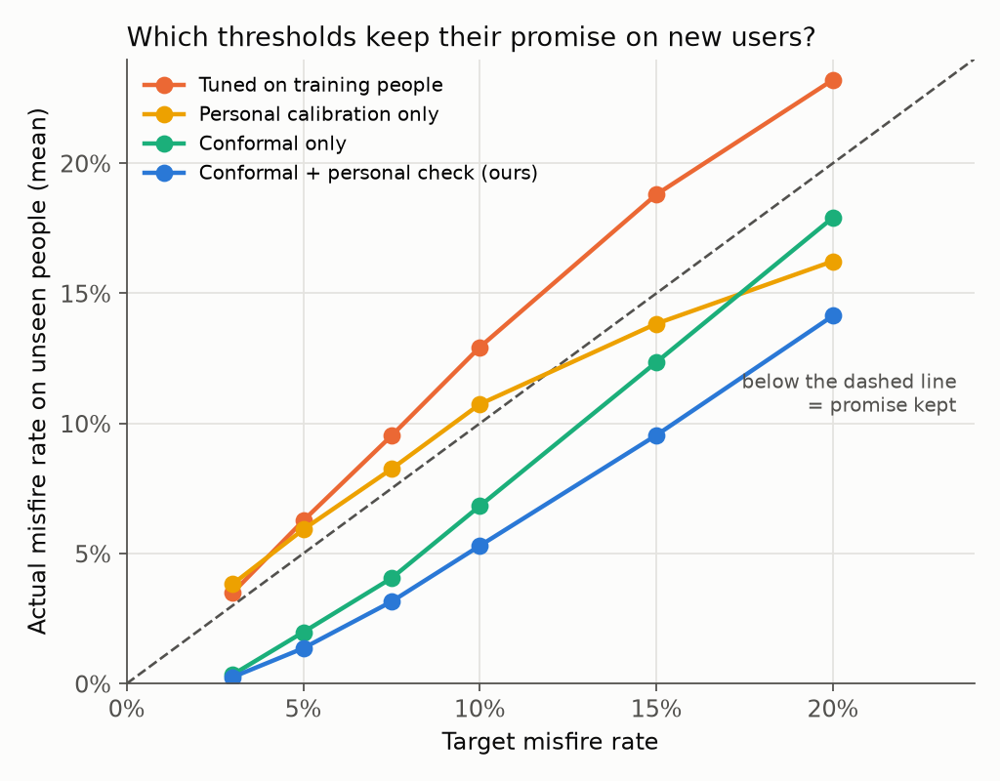
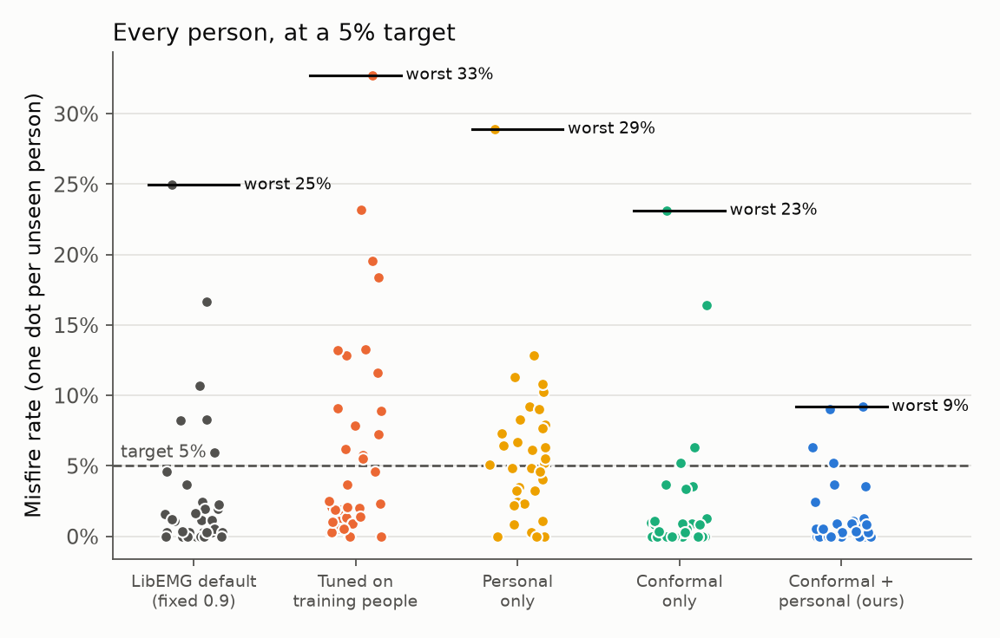
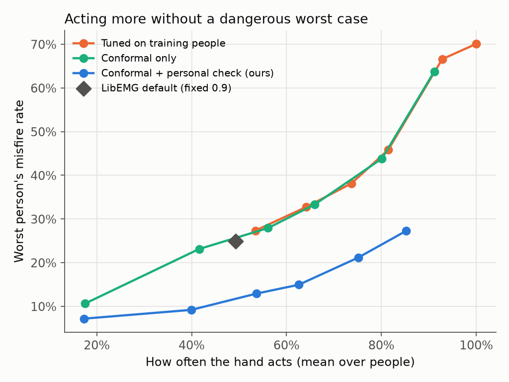

# SteadyHand

**Confidence cutoffs for prosthetic hand control that keep their promise on new users.**

**[Live demo](https://kishoren18-hue.github.io/steadyhand/)**: real forearm muscle recordings from people the model never saw, replayed at real speed, with two controllers deciding every 50 ms whether to move the hand.



## The problem

Muscle-controlled (myoelectric) prosthetic hands read EMG signals from the forearm and guess which gesture the user means. A wrong guess moves the hand when the user didn't ask it to. A common safety layer is *rejection*: move only when the classifier is confident, otherwise hold still.

[LibEMG](https://github.com/LibEMG/libemg), an open-source myoelectric control library, implements rejection as a fixed cutoff on the classifier's top probability (0.90 by default). The trouble is that a fixed number doesn't tell you how often the hand will misfire for a new person. Classifier confidence is often overconfident, and it gets worse on people whose signals look different from the training data, which is every new user.

So the question this project asks is simple: **if I tell the controller "misfire at most 5% of the time," does it keep that promise for someone it has never seen?**

## What I changed

SteadyHand keeps LibEMG's features, classifier and rejection rule exactly as they are, and changes only how the cutoff is chosen:

1. **Conformal risk control across people.** Each training person is scored by a model that never saw them (5-fold cross-fitting). Treating people as the exchangeable unit, conformal risk control ([Angelopoulos et al., ICLR 2024](https://arxiv.org/abs/2208.02814)) picks the lowest cutoff whose corrected misfire rate stays under the target. If a new user is exchangeable with the calibration users, their *expected* misfire rate is at most the target.
2. **A personal check that can only make it stricter.** A short labeled recording from the new user (their first series, like the guided calibration commercial devices already ask for) gives a second cutoff. SteadyHand uses whichever cutoff is higher. Raising the cutoff can only lower misfires, so the guarantee from step 1 still holds, and the people the model fits worst get extra protection.

A **misfire** is a 50 ms decision where the hand moves and the gesture is wrong. Misfire rate = misfires / all decisions.

## Setup

- **Data:** UCI [EMG Data for Gestures](https://archive.ics.uci.edu/dataset/481/emg+data+for+gestures) (Krilova et al., 2018). 36 able-bodied people, 8-channel Myo armband, 6 gestures (rest, fist, wrist flexion, wrist extension, radial and ulnar deviation), two recording series each.
- **Features and classifier:** LibEMG windowing (250 ms windows, 50 ms step) and Hudgins time-domain features (MAV, ZC, SSC, WL); LibEMG's `EMGClassifier("LDA")`, the standard choice in myoelectric control.
- **Evaluation:** leave one person out, 36 times. Train on 35 people, choose each cutoff, test on the held-out person's second series.
- **Sanity check:** with no rejection the classifier gets **76.8%** mean accuracy on unseen people, in line with the ~77-78% reported for cross-subject evaluation on this dataset ([EMGBench, NeurIPS 2024](https://arxiv.org/abs/2410.23625)).

Methods compared:

| Method | How the cutoff is picked |
|---|---|
| `fixed` | LibEMG default, 0.90 |
| `tuned` | lowest cutoff that meets the target on the training people's own data |
| `personal` | lowest cutoff that meets the target on the new user's first series |
| `conformal` | conformal risk control on out-of-person scores |
| `conformal+personal` | the higher of `conformal` and `personal` (**SteadyHand**) |

## Results (LDA, 36 unseen people)

| Method | Target | Mean misfire | Worst person | People over target | Hand moves |
|---|---|---|---|---|---|
| fixed (0.90) | none | 2.8% | 24.9% | n/a | 49% |
| tuned | 5% | 6.3% | 32.7% | 42% | 64% |
| tuned | 10% | 12.9% | 45.9% | 53% | 81% |
| personal | 5% | 5.9% | 28.9% | 53% | 66% |
| personal | 10% | 10.7% | 36.3% | 58% | 79% |
| conformal | 5% | 2.0% | 23.1% | 11% | 42% |
| conformal | 10% | 6.8% | 33.3% | 25% | 66% |
| **conformal+personal** | **5%** | **1.4%** | **9.2%** | **11%** | **40%** |
| **conformal+personal** | **10%** | **5.3%** | **14.9%** | **25%** | **63%** |

Full tables for six targets (3% to 20%) are in `results/summary_LDA.csv`; per-person numbers are in `results/per_person_LDA.csv`.

**What I found**

- **Tuning the cutoff on your own training data breaks the promise at every target.** Asked for at most 5% misfires, new users averaged 6.3%; asked for 10%, they got 12.9%. The classifier is more confident on people it has seen.
- **The conformal cutoff keeps the promise on average at every target**, from 3% to 20%.
- **Adding the personal check shrinks the worst case.** At a 5% target the worst person's misfire rate drops from 23.1% (conformal alone) to 9.2%. LibEMG's fixed default has a worst person at 24.9%.
- **Versus the fixed default (LDA):** at a 7.5% target SteadyHand moves the hand slightly more often (54% vs 49% of decisions) while halving the worst person's misfire rate (12.9% vs 24.9%), at a slightly higher average (3.2% vs 2.8%).





### Robustness check: random forest

Same pipeline with LibEMG's `EMGClassifier("RF")` (50 trees to keep the 216 fits short). Accuracy on unseen people without rejection: **83.3%**.

| Method | Target | Mean misfire | Worst person | People over target | Hand moves |
|---|---|---|---|---|---|
| fixed (0.90) | none | 0.6% | 5.8% | n/a | 41% |
| tuned | 5% | 16.7% | 55.0% | 81% | 100% |
| tuned | 10% | 16.7% | 55.0% | 72% | 100% |
| conformal | 5% | 2.3% | 17.3% | 14% | 57% |
| conformal | 10% | 7.2% | 28.5% | 31% | 78% |
| **conformal+personal** | **5%** | **1.9%** | **17.3%** | **8%** | **56%** |
| **conformal+personal** | **10%** | **5.8%** | **28.5%** | **14%** | **74%** |

- **Tuning on training data fails completely here.** A random forest is nearly certain on data it was trained on, so the tuned cutoff drops to zero and the hand acts on every decision, giving 16.7% misfires at every target.
- **Conformal keeps the average promise at all six targets again**, and the personal check cuts the share of people above target (at 10%: 31% to 14%). Unlike LDA, it doesn't lower the single worst person at 5% or 10%.
- **A fixed cutoff means different things for different classifiers.** LibEMG's 0.90 gives 2.8% misfires with LDA and 0.6% with a random forest. With the random forest it happens to be safe but cautious; with LDA its worst person hits 24.9%. A target-based cutoff says what you'll get no matter which classifier is plugged in.

Full tables: `results/summary_RF.csv`, `results/per_person_RF.csv`.

## Limits

- Offline only: recorded data replayed through the controller, no physical hand, no closed-loop use.
- 36 able-bodied people from one dataset. Amputee EMG is different and this has not been tested on it.
- The guarantee is **on average across people**, not for each person. At a 5% target, 4 of 36 people (11%) still land above it with LDA.
- How much the personal check helps the worst-off user depends on the classifier: a lot with LDA, little with a random forest at low targets.
- The conformal correction is conservative with 35 calibration people (it needs targets above about 3%), so at low targets the hand acts less often than it could.
- Misfires are counted per 50 ms decision. Real prosthetic controllers often add majority voting over several decisions, which this doesn't model.

## Run it

Python 3.10 to 3.12 (LibEMG requires `numpy<2.0`).

```bash
python -m venv .venv && source .venv/bin/activate
pip install -r requirements.txt

# dataset (the authors' own copy on GitHub, same files as the UCI download)
git clone https://github.com/UNNLobachevsky/EMG_data_for_gestures.git data/uci

python src/evaluate.py --data data/uci              # ~30 s, writes results/
python src/evaluate.py --data data/uci --model RF   # robustness check, ~40 min
python src/plots.py                                 # writes figures/
python src/build_demo.py                            # writes docs/index.html
```

## Files

```
src/data.py         load UCI data, LibEMG windows and features
src/methods.py      LibEMG classifier wrapper and the cutoff methods
src/evaluate.py     leave-one-person-out evaluation
src/plots.py        figures
src/build_demo.py   builds the interactive demo page
demo/template.html  demo page source
docs/index.html     built demo (served by GitHub Pages)
results/            summary and per-person CSVs, demo data
```

## References

- E. Eddy, E. Campbell, A. Phinyomark, S. Bateman, E. Scheme. "LibEMG: An Open Source Library to Facilitate the Exploration of Myoelectric Control." *IEEE Access* 11 (2023). doi:10.1109/ACCESS.2023.3304544
- E. Scheme, B. Hudgins, K. Englehart. "Confidence-Based Rejection for Improved Pattern Recognition Myoelectric Control." *IEEE Trans. Biomedical Engineering* 60(6), 2013. doi:10.1109/TBME.2013.2238939
- A. Angelopoulos, S. Bates, A. Fisch, L. Lei, T. Schuster. "Conformal Risk Control." *ICLR* 2024.
- N. Krilova, I. Kastalskiy, V. Kazantsev, V. Makarov, S. Lobov. "EMG Data for Gestures." UCI Machine Learning Repository, 2018. doi:10.24432/C5ZP5C
- J. Yang, M. Soh, V. Lieu, D. Weber, Z. Erickson. "EMGBench: Benchmarking Out-of-Distribution Generalization and Adaptation for Electromyography." *NeurIPS* 2024.

## License

MIT. LibEMG is used as a dependency under its own MIT license.
