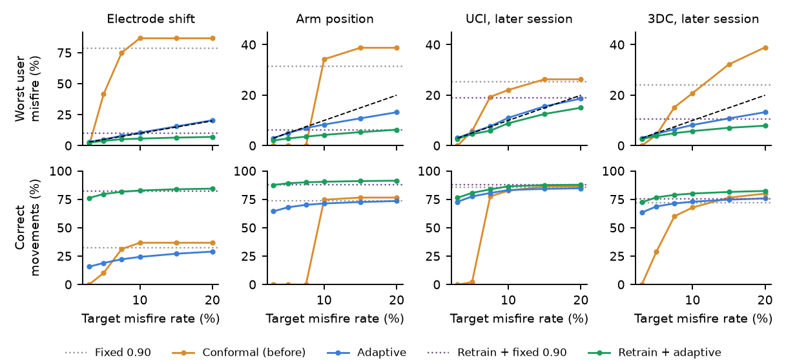

# SteadyHand

**Rejection cutoffs for myoelectric prosthesis control with a misfire-rate guarantee for every user, including after the armband shifts.**

[](https://github.com/kishoren18-hue/steadyhand/actions/workflows/tests.yml)


[](https://doi.org/10.5281/zenodo.23990312)

**[Live demo](https://kishoren18-hue.github.io/steadyhand/)** · [Quickstart](#quickstart) · [Results](#results) · [Paper](paper/main.pdf) · [Cite](#citation)

Muscle-controlled prosthetic hands guess which motion the user wants and move only when the classifier is confident. The confidence cutoff is a fixed number, so nobody knows how often the hand will move the wrong way. **After a 45-degree armband shift, LibEMG's default cutoff of 0.90 moved the hand unintentionally on 44% of decisions, even with a model trained for each user.**

SteadyHand picks the cutoff from a target instead, such as "move the wrong way on at most 5% of decisions":

| | Guarantee | Needs |
|---|---|---|
| `ConformalCutoff` | A new user's **expected** misfire rate is at most the target | Recordings of previous users under the same conditions |
| `AdaptiveCutoff` | **Each** user's misfire rate is at most the target plus a term that shrinks over time, on **any** data sequence | A bit per decision: did the hand move wrongly? (for example from a cued task) |
| `AdaptiveCutoff(feedback_rate=p)` | The same bound **in expectation**, with feedback on a random share p of decisions | Feedback on some decisions only |

All of them plug into [LibEMG](https://github.com/LibEMG/libemg)'s rejection block without changing its features, classifiers or decision rule.

**What counts as a misfire.** The hand moves in a way the user did not intend: the output is a motion (not "hold still", not "rest") and differs from the intended motion. A confident "rest" while the user wants to move is a *missed movement*: it costs usability, so we report correct movements alongside every misfire rate.



## Results

**91 people across four public datasets**, each held out and never seen by the model or the calibration step. Every number below is regenerated by `python experiments/paper_assets.py`.

### 1. A cutoff alone cannot fix a broken model

After the armband shift, each user's own model fell to 47% accuracy. At a 5% target:

| Electrode shift (21 people) | Mean misfire | Worst user | Correct movements |
|---|---|---|---|
| LibEMG fixed 0.90 | 44.0% | 78.5% | 32.6% |
| Per-class ROC cutoffs (Menon et al. 2015) | 39.5% | 71.5% | 29.6% |
| Conformal, calibrated before the shift | 15.4% | 41.6% | 10.2% |
| Adaptive cutoff alone | 4.9% | 5.0% | **19.0%** |

The adaptive cutoff keeps its promise, but it can only trade wrong movements for missed ones.

### 2. Retraining fixes accuracy but not the promise; the two together do both

Retraining the model every 5 seconds from the same feedback raised post-shift accuracy to 89%. Across all four datasets at a 5% target:

| All 91 people | Users above 5% | Worst user | Correct movements |
|---|---|---|---|
| Retrain + LibEMG 0.90 | 44 / 91 | 19.0% | 83.6% |
| **Retrain + adaptive cutoff** | **0 / 91** | **4.6%** | **80.6%** |

With retraining plus the adaptive cutoff, **no user went over the target at any of the six levels tested (3% to 20%) on any of the four datasets.** The guarantee costs 2.9 percentage points of correct movements.

### 3. Conformal cutoffs keep the promise on average for new users

With a model shared across people, cutoffs tuned on the training data broke every target on new users (5% asked, 6.5% on UCI and 12.1% on 3DC delivered). Conformal cutoffs met all 6 targets on average on both datasets, with and without LibEMG's majority voting. A personal check on the new user's calibration recording, which can only raise the cutoff, cut the worst UCI user at a 5% target from 23.1% to 9.3%.

### 4. With feedback on only 10% of decisions

The importance-weighted update keeps its bound in expectation (it held in all 546 runs), and retraining plus the adaptive cutoff met every target on average on every dataset, but **7 of 91 users went above 5% (worst 10.0%)**. Sparse feedback is the main open problem.

### 5. Acting on what's certain helps grasping

Three 3DC classes close the hand. Rejecting on the motion ("close") instead of the specific grip let user-specific models perform grip motions on 72% of grip decisions instead of 49%, at the same 4.6% misfire rate.

## Quickstart

```bash
pip install -e .                 # just the cutoffs (numpy only)
pip install -e ".[experiments]"  # plus LibEMG and everything to reproduce the paper
```

```python
from steadyhand import ConformalCutoff, AdaptiveCutoff

REST = 0   # class index of "rest" in your gesture set

# previous users, each scored by a model that never trained on them:
# a list of dicts with arrays "pred", "conf", "y"
cut = ConformalCutoff(target=0.05, rest=REST).fit(previous_users)
classifier.add_rejection(threshold=cut.threshold_)     # LibEMG EMGClassifier

# per-user adaptive cutoff inside your own control loop
ad = AdaptiveCutoff(target=0.05, start=cut.threshold_)
act = ad.should_act(confidence)
...
ad.update(misfire=act and pred != REST and pred != intended)   # when feedback arrives
print(ad.bound())                                              # guaranteed bound so far
```

A full worked example on real data: [`examples/quickstart.py`](examples/quickstart.py).

## How it works

**Conformal cutoff.** Score each previous user with a model that never saw them (5-fold cross-fitting), compute their misfire rate at every cutoff, and pick the smallest cutoff with (n · average + 1)/(n + 1) ≤ target ([conformal risk control](https://arxiv.org/abs/2208.02814), with people as the exchangeable unit). Targets below 1/(n + 1) need more calibration people. For majority voting, an exact algorithm computes voted misfire rates at every cutoff; it matches LibEMG's own voting code output for output.

**Adaptive cutoff.** On a log confidence scale s = −log₁₀(1 − confidence), act if s > τ. After each decision, τ ← max(τ + η(m − target), 0), where m = 1 for a misfire. The same update as adaptive conformal inference ([Gibbs and Candès, 2021](https://arxiv.org/abs/2106.00170)) gives, for every sequence and every T:

```
misfire rate over T decisions  ≤  target + (6 + η − τ₁) / (η T)
```

**Sparse feedback.** Updating only on labeled decisions moves τ p times slower. Instead, every decision updates τ with the weighted misfire F·m/p, where F = 1 if this decision got feedback. The same argument bounds the weighted rate surely, and since E[F·m/p] = m, the expected true rate over all decisions obeys the same bound. Proofs are in [`steadyhand/adaptive.py`](steadyhand/adaptive.py) and the paper.

**Retraining.** Every 100 decisions (5 s), the model is refit on its training data plus every labeled decision so far, and the adaptive cutoff runs on top. The bounds still hold, because they hold for any sequence of decisions.

## Data

| Dataset | People | Change between calibration and use |
|---|---|---|
| [UCI EMG Data for Gestures](https://archive.ics.uci.edu/dataset/481/emg+data+for+gestures) | 36 | Later session, same day |
| [3DC](https://github.com/libemg/3DCDataset) | 22 | Later session after a 5-minute break; 11 classes |
| [CIIL electrode shift](https://github.com/LibEMG/CIILData) | 21 | 45-degree armband rotation |
| [Fougner limb position](https://github.com/libemg/LimbPosition) | 12 | 4 new arm positions |

## Reproduce

Python 3.10 to 3.12 (LibEMG requires `numpy<2.0`).

```bash
pip install -e ".[experiments,test]"
git clone https://github.com/UNNLobachevsky/EMG_data_for_gestures.git data/uci
git clone https://github.com/libemg/3DCDataset.git data/3dc
git clone https://github.com/LibEMG/CIILData.git data/ciil
git clone https://github.com/libemg/LimbPosition.git data/limbpos

python -m pytest tests contrib/libemg -q                                       # 267 tests
python experiments/evaluate.py --dataset uci --data data/uci --vote 5 --personalize
python experiments/evaluate.py --dataset 3dc --data data/3dc --vote 5 --personalize
python experiments/evaluate.py --dataset uci --data data/uci --model RF
python experiments/drift.py --dataset ciil --data data/ciil/ElectrodeShift
python experiments/drift.py --dataset limbpos --data data/limbpos/FougnerLimbPosition
python experiments/drift.py --dataset uci --data data/uci
python experiments/drift.py --dataset 3dc --data data/3dc
python experiments/groups.py --data data/3dc
python experiments/paper_assets.py   # every number, table and figure in the paper and this README
python experiments/build_demo.py     # docs/index.html
```

On a 2-core machine the full run takes about half an hour.

## Limits

- Offline: recorded data replayed through the controller. No live user adapting in closed loop, no physical hand. Offline error is an imperfect proxy for real-time usability.
- Able-bodied participants only; calibration and test on the same day.
- Feedback assumes a cued task. Daily use would need implicit signals, such as the user undoing a movement.
- With feedback on 10% of decisions, the guarantee is in expectation and some users go over the target.
- Conformal cutoffs need many calibration people and were conservative.
- Every misfire counts the same, though opening during a grasp is worse than a wrong wrist rotation.

## Repository

```
steadyhand/        the package: ConformalCutoff, AdaptiveCutoff, misfire curves, voting
experiments/       every experiment, figure and table
tests/             254 tests, including against LibEMG's own code and worst-case sequences
contrib/libemg/    a self-contained module proposed for inclusion in LibEMG
examples/          quickstart on real data
paper/             IEEE-format paper; numbers.tex is generated from results/
results/           per-person results for every method
docs/              interactive demo (GitHub Pages)
```

## Citation

```bibtex
@software{nuthalapati_steadyhand_2026,
  author  = {Nuthalapati, Kishore},
  title   = {SteadyHand: rejection cutoffs for myoelectric control with misfire-rate guarantees},
  year    = {2026},
  version = {0.3.0},
  doi     = {10.5281/zenodo.23990312},
  url     = {https://github.com/kishoren18-hue/steadyhand}
}
```

## References

- E. Eddy, E. Campbell, A. Phinyomark, S. Bateman, E. Scheme. LibEMG: an open source library to facilitate the exploration of myoelectric control. *IEEE Access* 11, 2023.
- E. Scheme, B. Hudgins, K. Englehart. Confidence-based rejection for improved pattern recognition myoelectric control. *IEEE Trans. Biomed. Eng.* 60(6), 2013.
- R. Menon et al. Automatic misclassification rejection for LDA classifier using ROC curves. *IEEE EMBC*, 2015.
- J. W. Robertson, K. B. Englehart, E. J. Scheme. Effects of confidence-based rejection on usability and error in pattern recognition-based myoelectric control. *IEEE JBHI* 23(5), 2019.
- A. Angelopoulos, S. Bates, A. Fisch, L. Lei, T. Schuster. Conformal risk control. *ICLR* 2024.
- I. Gibbs, E. Candès. Adaptive conformal inference under distribution shift. *NeurIPS* 2021.
- E. Campbell, E. Eddy, S. Bateman, U. Côté-Allard, E. Scheme. Context-informed incremental learning improves both the performance and resilience of myoelectric control. *J. NeuroEng. Rehabil.* 21, 2024.
- A. Fougner, E. Scheme, A. Chan, K. Englehart, Ø. Stavdahl. Resolving the limb position effect in myoelectric pattern recognition. *IEEE TNSRE* 19(6), 2011.
- U. Côté-Allard et al. Deep learning for electromyographic hand gesture signal classification using transfer learning. *IEEE TNSRE* 27(4), 2019.
- N. Krilova et al. EMG Data for Gestures. UCI Machine Learning Repository, 2018.

## Acknowledgments

Datasets by Krilova et al., Côté-Allard et al., Campbell et al. and Fougner et al.; LibEMG by the University of New Brunswick team. AI assistance in this project is disclosed in the paper's acknowledgment section.

## License

MIT. LibEMG is used as a dependency under its own MIT license.
