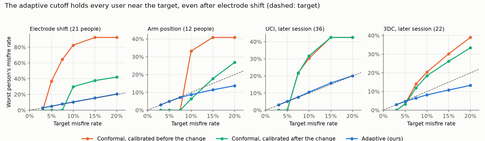
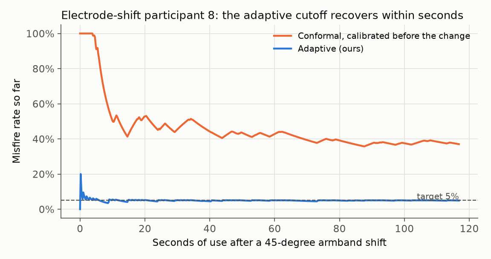
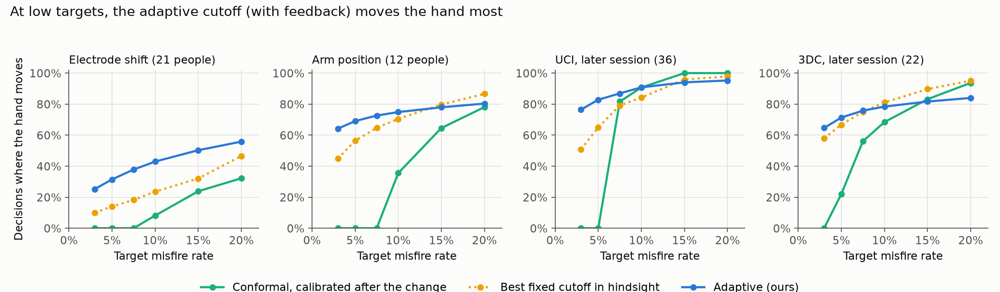

# SteadyHand

**Confidence cutoffs for myoelectric prosthesis control that keep their promise, for every user, even after the armband shifts.**

[](https://github.com/kishoren18-hue/steadyhand/actions/workflows/tests.yml)


[](https://doi.org/10.5281/zenodo.23990312)

**[Live demo](https://kishoren18-hue.github.io/steadyhand/)** · [Quickstart](#quickstart) · [Results](#results) · [Cite](#citation)

Muscle-controlled prosthetic hands guess which gesture the user wants and act only when the classifier is confident. The confidence cutoff is usually a fixed number. **After a 45-degree armband shift, LibEMG's default cutoff of 0.90 makes the hand move the wrong way on 46% of decisions, even with a model trained for each user.**

SteadyHand replaces that fixed number with one chosen from a target, such as "misfire on at most 5% of decisions," and gives two guarantees:

| | Guarantee | Needs |
|---|---|---|
| `ConformalCutoff` | A new user's **expected** misfire rate is at most the target | Recordings of previous users under the same conditions |
| `AdaptiveCutoff` | **Each** user's misfire rate stays at most the target plus a term that shrinks over time, on **any** data sequence: electrode shift, arm position, fatigue | Feedback on whether decisions were right (for example from a cued task) |

Both plug into [LibEMG](https://github.com/LibEMG/libemg)'s rejection block without changing its features, classifiers or decision rule.



## Results

Evaluated on **91 people across four public datasets**, each person held out and never seen by the model or the calibration step.

### 1. A fixed cutoff can't tell you what you'll get

| Condition (own model per user) | LibEMG 0.90: mean misfire | Worst user |
|---|---|---|
| Later session, UCI (36 people) | 10.8% | 39.1% |
| Later session, 3DC (22 people) | 10.7% | 25.0% |
| New arm positions (12 people) | 20.5% | 33.7% |
| 45-degree electrode shift (21 people) | **46.1%** | **82.1%** |

Tuning the cutoff on the training data doesn't fix it: with a shared model, a cutoff tuned for 5% gave new users 6.3% (UCI) and 10.4% (3DC), and it broke the target at all 6 levels tested on both datasets.

### 2. Conformal cutoffs keep the promise on average, if calibration matches use

With a shared model, the conformal cutoff kept the average misfire rate at or below the target at **all 6 targets on both UCI and 3DC**, with and without LibEMG's majority voting. A personal check on the new user's calibration recording, which can only raise the cutoff, cut the worst user at a 5% target from 23.1% to **9.2%** (UCI).

But **when conditions change after calibration, the average guarantee breaks.** Calibrated before an electrode shift, a 5% promise gave 12.0% (worst user 37.0%). Calibrated on other people after the same shift, it held, but the hand stayed still at every target up to 7.5%.

### 3. The adaptive cutoff holds each user at the target, and moves the hand far more

| 5% target, own model per user | Conformal (calibrated before change) | Adaptive, feedback on every decision |
|---|---|---|
| Electrode shift: mean / worst user | 12.0% / 37.0% | **4.9% / 5.0%** |
| Electrode shift: hand moves | 25.6% | **31.5%** |
| Arm position: mean / worst user / hand moves | 0.0% / 0.0% / 0.0% | **4.0% / 5.0% / 69.1%** |
| UCI later session: hand moves | 0.0% | **82.8%** |
| 3DC later session: hand moves | 24.3% | **71.4%** |

- **The guarantee never failed:** 0 violations in 1,365 runs (91 people × targets × step sizes), and it is also tested on worst-case and drifting sequences in `tests/`.
- **It recovers quickly after an electrode shift:** in the example below, within a few seconds.
- **At 3% and 5% targets it moves the hand more than the best fixed cutoff chosen in hindsight** on all four datasets, because it can tighten during hard stretches and relax during easy ones.
- **Feedback on only 10% of decisions** kept the average promise on arm position, UCI and 3DC, but not after electrode shift, where the starting cutoff was far too low to recover from with so few labels.





### 4. "Act on what's certain" helps grasping, not weak models

Three 3DC gestures close the hand (power, chuck and pinch grip). Summing their probabilities, so the hand closes when it is sure it should close even if unsure which grip, let users with their own model perform grip motions on **69% of grip moments instead of 45%** at a 7.5% target, with the same misfire rate. It did not help the weak shared model (33% gesture accuracy).

### 5. The users a shared model fails have usable signals

UCI participant 22 reaches 39.6% accuracy with a shared model and 98.5% with their own. Across UCI, own models reach 93.6% against 76.8% shared; on 3DC, 85.6% against 33.3%.

All numbers: `python experiments/report.py` (saved in [`results/report.txt`](results/report.txt)).

## Quickstart

```bash
pip install -e .                 # just the cutoffs (numpy only)
pip install -e ".[experiments]"  # plus LibEMG and everything to reproduce the paper
```

```python
from steadyhand import ConformalCutoff, AdaptiveCutoff

# previous users, each scored by a model that never trained on them:
# a list of dicts with arrays "pred", "conf", "y"
cut = ConformalCutoff(target=0.05).fit(previous_users)
classifier.add_rejection(threshold=cut.threshold_)     # LibEMG EMGClassifier

# per-user adaptive cutoff inside your own control loop
ad = AdaptiveCutoff(target=0.05, start=cut.threshold_)
if ad.should_act(confidence):
    ...                                                # move the hand
ad.update(acted=True, correct=user_confirmed)          # when feedback arrives
print(ad.bound())                                      # guaranteed misfire bound so far
```

A full worked example on real data: [`examples/quickstart.py`](examples/quickstart.py).

## How it works

**Conformal cutoff.** Score each previous user with a model that never saw them (5-fold cross-fitting), compute their misfire rate at every cutoff, and pick the smallest cutoff with (n · average + 1)/(n + 1) ≤ target ([conformal risk control](https://arxiv.org/abs/2208.02814), with people as the exchangeable unit). For majority voting, an exact algorithm computes voted misfire rates at every cutoff; it matches LibEMG's own voting code output for output.

**Adaptive cutoff.** On a log confidence scale s = −log₁₀(1 − confidence), act if s > τ. After each decision with feedback, τ ← max(τ + η(m − target), 0), where m = 1 for a misfire. The same update as adaptive conformal inference ([Gibbs and Candès, 2021](https://arxiv.org/abs/2106.00170)) gives, for every sequence and every T:

```
misfire rate over T decisions  ≤  target + (6 + η − τ₁) / (η T)
```

The proof is five lines and is in [`steadyhand/adaptive.py`](steadyhand/adaptive.py).

## Data

| Dataset | People | Change between calibration and use |
|---|---|---|
| [UCI EMG Data for Gestures](https://archive.ics.uci.edu/dataset/481/emg+data+for+gestures) | 36 | Later session, same day |
| [3DC](https://github.com/libemg/3DCDataset) | 22 | Later session after a 5-minute break; 11 gestures |
| [CIIL electrode shift](https://github.com/LibEMG/CIILData) | 21 | 45-degree armband rotation |
| [Fougner limb position](https://github.com/libemg/LimbPosition) | 12 | 4 new arm positions |

## Reproduce

Python 3.10 to 3.12 (LibEMG requires `numpy<2.0`).

```bash
pip install -e ".[experiments,test]"
git clone https://github.com/UNNLobachevsky/EMG_data_for_gestures.git data/uci
git clone https://github.com/libemg/3DCDataset.git data/3dc
git clone https://github.com/LibEMG/CIILData.git data/ciil
git clone https://github.com/libemg/LimbPosition.git data/limbpos

python -m pytest tests -q                                                      # 190 tests
python experiments/evaluate.py --dataset uci --data data/uci --vote 5 --personalize
python experiments/evaluate.py --dataset 3dc --data data/3dc --vote 5 --personalize
python experiments/evaluate.py --dataset uci --data data/uci --model RF
python experiments/drift.py --dataset ciil --data data/ciil/ElectrodeShift
python experiments/drift.py --dataset limbpos --data data/limbpos/FougnerLimbPosition
python experiments/drift.py --dataset uci --data data/uci
python experiments/drift.py --dataset 3dc --data data/3dc
python experiments/groups.py --data data/3dc
python experiments/report.py      # every number in this README
python experiments/plots.py && python experiments/plots_drift.py
```

## Limits

- Offline: recorded data replayed through the controller. No live user, no physical hand.
- Able-bodied participants only.
- The conformal guarantee is on average across people; the adaptive guarantee needs feedback on whether each decision was right, which a cued task provides but daily use does not yet.
- With few feedback labels after a large change, the adaptive cutoff recovers too slowly (electrode shift, 10% feedback).
- Every misfire counts the same, though opening during a grasp is worse than a wrong wrist rotation.

## Repository

```
steadyhand/      the package: ConformalCutoff, AdaptiveCutoff, misfire curves, voting
experiments/     every experiment, figure and table
tests/           190 tests, including against LibEMG's own code and worst-case sequences
examples/        quickstart on real data
results/         per-person results for every method; report.txt
figures/         README figures
docs/            interactive demo (GitHub Pages)
```

## Citation

```bibtex
@software{nuthalapati_steadyhand_2026,
  author  = {Nuthalapati, Kishore},
  title   = {SteadyHand: rejection cutoffs for myoelectric control with misfire-rate guarantees},
  year    = {2026},
  version = {0.2.0},
  doi     = {10.5281/zenodo.23990312},
  url     = {https://github.com/kishoren18-hue/steadyhand}
}
```

## References

- E. Eddy, E. Campbell, A. Phinyomark, S. Bateman, E. Scheme. LibEMG: an open source library to facilitate the exploration of myoelectric control. *IEEE Access* 11, 2023.
- E. Scheme, B. Hudgins, K. Englehart. Confidence-based rejection for improved pattern recognition myoelectric control. *IEEE Trans. Biomed. Eng.* 60(6), 2013.
- A. Angelopoulos, S. Bates, A. Fisch, L. Lei, T. Schuster. Conformal risk control. *ICLR* 2024.
- I. Gibbs, E. Candès. Adaptive conformal inference under distribution shift. *NeurIPS* 2021.
- E. Campbell, E. Eddy, S. Bateman, U. Côté-Allard, E. Scheme. Context-informed incremental learning improves both the performance and resilience of myoelectric control. *J. NeuroEng. Rehabil.* 21, 2024.
- A. Fougner, E. Scheme, A. Chan, K. Englehart, Ø. Stavdahl. Resolving the limb position effect in myoelectric pattern recognition. *IEEE TNSRE* 19(6), 2011.
- U. Côté-Allard et al. Deep learning for electromyographic hand gesture signal classification using transfer learning. *IEEE TNSRE* 27(4), 2019.
- N. Krilova et al. EMG Data for Gestures. UCI Machine Learning Repository, 2018.
- J. Yang, M. Soh, V. Lieu, D. Weber, Z. Erickson. EMGBench. *NeurIPS* 2024.

## Acknowledgments

Code, experiments and documentation were developed with the assistance of Claude (Anthropic). Datasets by Krilova et al., Côté-Allard et al., Campbell et al. and Fougner et al.; LibEMG by the University of New Brunswick team.

## License

MIT. LibEMG is used as a dependency under its own MIT license.
