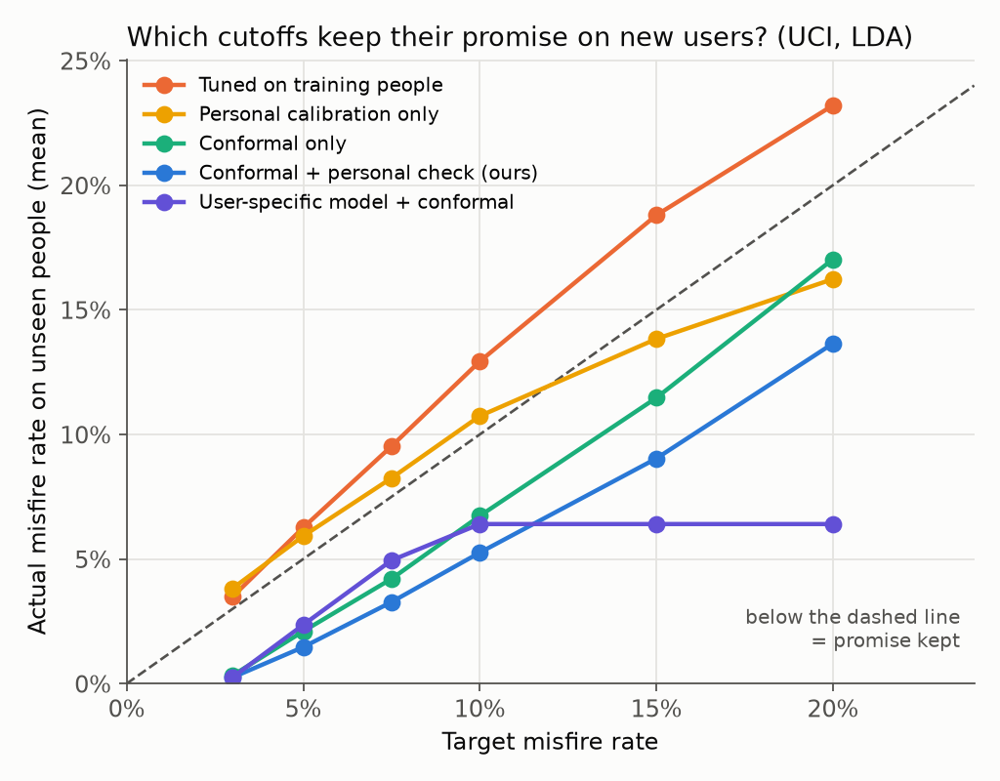
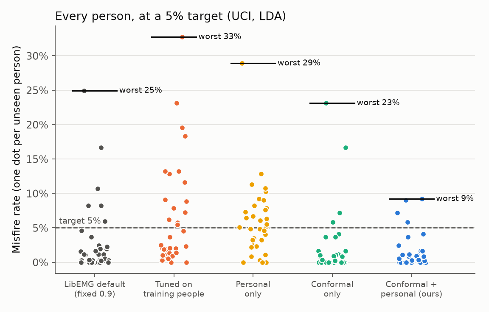
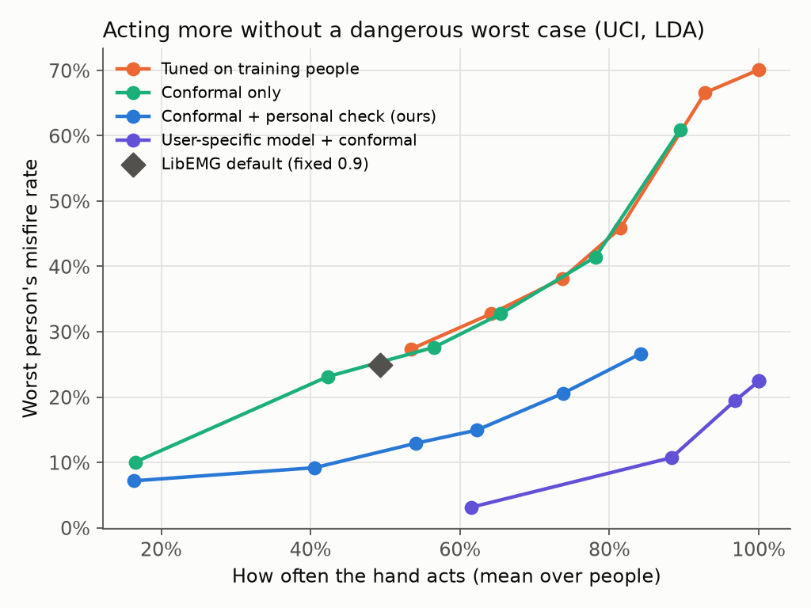

# SteadyHand

**Confidence cutoffs for prosthetic hand control that keep their promise on new users.**

**[Live demo](https://kishoren18-hue.github.io/steadyhand/)**: real forearm muscle recordings from a person the model never saw, replayed at real speed, with LibEMG's default controller next to SteadyHand.



## The problem

Muscle-controlled (myoelectric) prosthetic hands read EMG from the forearm and guess which gesture the user means. A wrong guess moves the hand when the user didn't ask it to. The usual safety layer is *rejection*: move only when the classifier is confident, otherwise hold still.

[LibEMG](https://github.com/LibEMG/libemg), an open-source myoelectric control library, implements rejection as a fixed cutoff on the classifier's top probability (0.90 by default). A fixed number doesn't tell you how often the hand will misfire for a new person: in this study the same 0.90 gave a 2.8% misfire rate with one classifier and 0.6% with another. Tuning the cutoff on training data is worse, because classifiers are overconfident on people they've seen.

**The question:** if I tell the controller "misfire on at most 5% of decisions," does a person it has never seen actually get that?

## What I changed

SteadyHand keeps LibEMG's features, classifier and rejection rule exactly as they are and changes only how the cutoff is chosen.

1. **Conformal risk control across people.** Each previous user is scored by a model that never saw them (5-fold cross-fitting). Treating people as the exchangeable unit, conformal risk control ([Angelopoulos et al., ICLR 2024](https://arxiv.org/abs/2208.02814)) picks the lowest cutoff whose corrected average misfire rate is under the target. A new user from the same population then has an *expected* misfire rate at most the target.
2. **A personal check that can only make it stricter.** The new user's short calibration session gives a second cutoff, and SteadyHand uses the larger one. Raising the cutoff can only lower misfires, so the guarantee still holds and the worst case shrinks.
3. **Majority voting.** An exact, fast algorithm computes misfire rates after LibEMG's 5-decision majority vote at every cutoff, so the cutoff can be calibrated on what the hand actually does. It matches LibEMG's own voting code output for output (see `tests/`).
4. **User-specific models.** The same calibration works when each user gets a model trained only on their own calibration session, as long as previous users are scored the same way.

A **misfire** is a 50 ms decision where the hand moves and the gesture is wrong.

## Data and protocol

| | UCI EMG Data for Gestures | 3DC |
|---|---|---|
| People | 36 | 22 |
| Sensor | Myo armband, 8 channels | 3DC armband, 10 channels |
| Gestures | 6 | 11 (adds rotations and grips) |
| Sessions | calibration + test, about a minute apart | calibration + test, 5-minute break |
| Windows | 26,110 | 190,392 |

LibEMG windows (250 ms, 50 ms step), Hudgins time-domain features, `EMGClassifier("LDA")`. Leave one person out: train on everyone else, choose the cutoff, score the held-out person's test session. Targets from 3% to 20%.

## Results

| Dataset | Cutoff | Target | Mean misfire | Worst person | People over target | Hand moves |
|---|---|---|---|---|---|---|
| UCI | Fixed 0.90 (LibEMG) | none | 2.8% | 24.9% | | 49.3% |
| UCI | Tuned on training people | 5% | 6.3% | 32.7% | 15/36 | 64.1% |
| UCI | Conformal | 5% | 2.1% | 23.1% | 4/36 | 42.3% |
| UCI | **Conformal + personal** | **5%** | **1.5%** | **9.2%** | **4/36** | **40.5%** |
| UCI | **User-specific + conformal** | **5%** | **2.4%** | **10.7%** | **5/36** | **88.3%** |
| 3DC | Fixed 0.90 (LibEMG) | none | 5.2% | 26.5% | | 14.8% |
| 3DC | Tuned on training people | 10% | 18.3% | 76.6% | 16/22 | 35.7% |
| 3DC | Conformal | 10% | 5.3% | 26.9% | 4/22 | 15.0% |
| 3DC | **Conformal + personal** | **10%** | **3.4%** | **10.6%** | **1/22** | **12.6%** |
| 3DC | **User-specific + conformal** | **10%** | **5.7%** | **17.4%** | **2/22** | **81.8%** |

Every number for every target, method and person is in `results/`; `python src/report.py` prints them all (saved in `results/report.txt`).

**What I found**

- **Tuning on training data broke the promise at all 6 targets on both datasets.** Asked for 5%, new users got 6.3% (UCI) and 10.4% (3DC).
- **Every conformal variant kept the promise on average at all 6 targets on both datasets**, with and without majority voting.
- **The personal check shrinks the worst case.** UCI, 5% target: worst person 23.1% → 9.2%. 3DC, 10%: 26.9% → 10.6%.
- **User-specific models make the promise practical.** They reach 93.6% (UCI) and 85.6% (3DC) accuracy versus 76.8% and 33.3% for the shared model, and with conformal cutoffs the hand moves on 88% of decisions at a 5% target on UCI instead of 41%.
- **The users the shared model fails aren't bad signal sources.** UCI person 22: 39.6% accuracy with the shared model, 98.5% with their own model.
- **Classifier check:** with a random forest on UCI, both conformal variants again kept all 6 targets; the tuned cutoff fell to zero and the hand acted on everything (16.7% misfires at every target).





More figures for 3DC and the random forest are in `figures/`.

## Limits

- Offline only: recorded data replayed through the controller, no physical hand, no closed-loop use.
- Able-bodied participants only. Residual-limb EMG is different and untested here.
- Calibration and test sessions are minutes apart on the same day, so electrode shift and multi-day drift are untested.
- The guarantee is **on average across people**, not for each person. At a 5% target, 4 of 36 UCI users still went over.
- With n calibration people no target below 1/(n + 1) is reachable: 2.8% on UCI, 4.5% on 3DC. On 3DC's weak shared model, keeping a low target means the hand barely moves.
- Every misfire counts the same, though opening during a grasp is worse than a wrong wrist rotation.

## Run it

Python 3.10 to 3.12 (LibEMG requires `numpy<2.0`).

```bash
python -m venv .venv && source .venv/bin/activate
pip install -r requirements.txt

# datasets (GitHub copies of the public datasets)
git clone https://github.com/UNNLobachevsky/EMG_data_for_gestures.git data/uci
git clone https://github.com/libemg/3DCDataset.git data/3dc

python -m pytest tests                                                     # 4 checks, seconds
python src/evaluate.py --dataset uci --data data/uci --vote 5 --personalize # about 2 min
python src/evaluate.py --dataset 3dc --data data/3dc --vote 5 --personalize # about 10 min
python src/evaluate.py --dataset uci --data data/uci --model RF            # classifier check
python src/report.py        # every number in the README and paper
python src/plots.py         # figures/
python src/build_demo.py    # docs/index.html
```

## Files

```
src/data.py         load both datasets into one format, LibEMG windows and features
src/methods.py      LibEMG classifier wrapper, cutoff rules, conformal risk control, voting
src/evaluate.py     leave-one-person-out evaluation of every method
src/report.py       prints every table and number used in the paper
src/plots.py        figures
src/build_demo.py   builds the interactive demo page
tests/              checks against brute force and against LibEMG's own code
demo/template.html  demo page source
docs/index.html     built demo (served by GitHub Pages)
results/            summaries, per-person results, demo data, report.txt
```

## References

- E. Eddy, E. Campbell, A. Phinyomark, S. Bateman, E. Scheme. "LibEMG: An Open Source Library to Facilitate the Exploration of Myoelectric Control." *IEEE Access* 11 (2023). doi:10.1109/ACCESS.2023.3304544
- E. Scheme, B. Hudgins, K. Englehart. "Confidence-Based Rejection for Improved Pattern Recognition Myoelectric Control." *IEEE Trans. Biomedical Engineering* 60(6), 2013. doi:10.1109/TBME.2013.2238939
- A. Angelopoulos, S. Bates, A. Fisch, L. Lei, T. Schuster. "Conformal Risk Control." *ICLR* 2024.
- N. Krilova, I. Kastalskiy, V. Kazantsev, V. Makarov, S. Lobov. "EMG Data for Gestures." UCI Machine Learning Repository, 2018. doi:10.24432/C5ZP5C
- U. Côté-Allard et al. "Deep Learning for Electromyographic Hand Gesture Signal Classification Using Transfer Learning." *IEEE TNSRE* 27(4), 2019.
- J. Yang, M. Soh, V. Lieu, D. Weber, Z. Erickson. "EMGBench: Benchmarking Out-of-Distribution Generalization and Adaptation for Electromyography." *NeurIPS* 2024.

## Acknowledgments

Built with the assistance of Claude (Anthropic) for code, experiments and drafting. Datasets by Krilova et al. and Côté-Allard et al.; LibEMG by the University of New Brunswick team.

## License

MIT. LibEMG is used as a dependency under its own MIT license.
